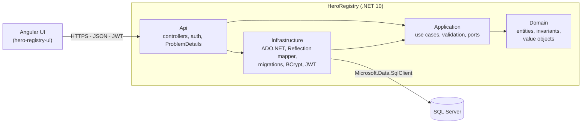
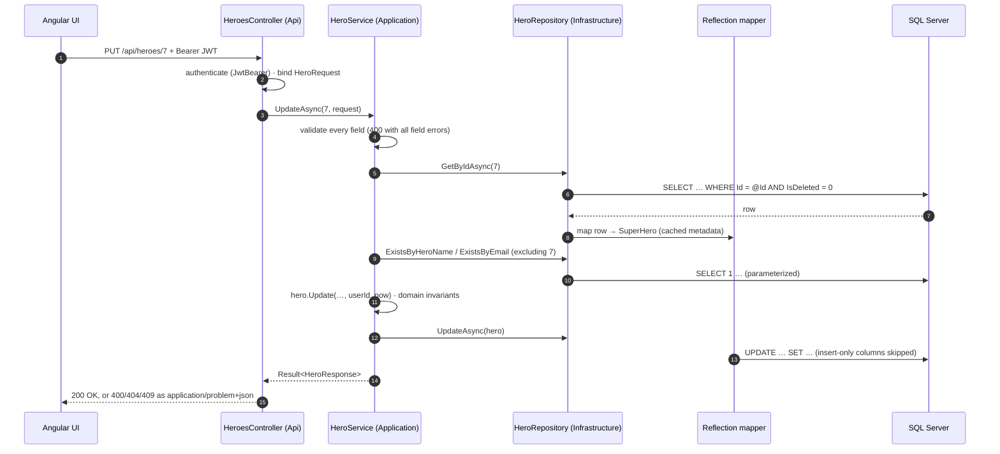
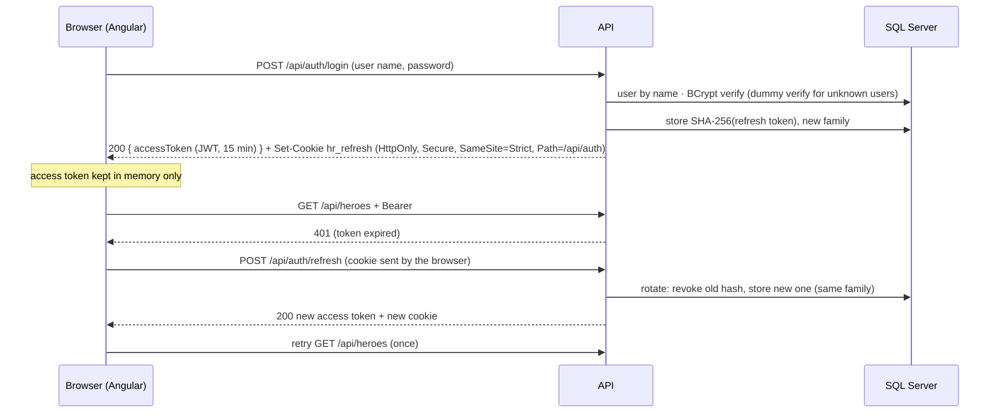

# Architecture

SuperHero Registry is a .NET 10 Web API built with **Clean Architecture**, a **SQL Server** database reached through **ADO.NET and a Reflection-based mapper** (no Entity Framework, Dapper or MediatR), and an **Angular 22** front end. This page explains how the pieces fit together; the [README](../README.md) covers setup.

## Layers and the dependency rule



| Project | Responsibility | Depends on |
| ------- | -------------- | ---------- |
| `HeroRegistry.Domain` | Entities (`SuperHero`, `User`, `RefreshToken`), invariants, value objects (`EmailAddress`, `UsStateCode`, `ZipCode`), business rule constants | nothing |
| `HeroRegistry.Application` | Use cases (`HeroService`, `AuthService`, `UserService`), request validation, the `Result`/`Error` model, **ports** (`IHeroRepository`, `ITokenService`, …) | Domain |
| `HeroRegistry.Infrastructure` | Implements the ports: SQL repositories on the Reflection mapper, the migration runner, BCrypt, JWT, refresh-token hashing, data-access telemetry | Application, Domain |
| `HeroRegistry.Api` | ASP.NET Core controllers, JWT authentication, authorization policies, RFC 9457 errors, OpenAPI and Scalar | Application, Infrastructure (composition root only) |
| `HeroRegistry.ServiceDefaults` | OpenTelemetry, health checks, Application Insights | none of the above |
| `HeroRegistry.AppHost` | .NET Aspire orchestration for development (SQL Server, API, UI) | Api |

The rule "inner layers never reference outer ones" is **enforced by tests** (`Application.Tests/Architecture`): the Domain declares no project references, the Application references only the Domain, and no project references Entity Framework, Dapper or MediatR.

The business logic is independent of the data layer and the API, as the exercise requires. Use cases depend on interfaces; Infrastructure provides the implementations, wired up in `Program.cs`.

## A request, end to end

`PUT /api/heroes/7`, signed in as a regular user:



Use cases return a `Result<T>` (success or an `Error` with a type, a stable code and field errors) instead of throwing for expected failures. The API maps the error type to the status code, in one place (`ApiControllerBase`).

## The Reflection data layer

The exercise forbids Entity Framework, Dapper and MediatR. The data layer uses plain **ADO.NET** (`Microsoft.Data.SqlClient`) and maps objects to rows with **Reflection**, configured by a small fluent map per entity:

```csharp
internal sealed class SuperHeroMap : AuditableEntityMap<SuperHero>
{
    public SuperHeroMap()
    {
        ToTable("SuperHeroes");
        Property(h => h.HeroName).HasMaxLength(HeroNameMaxLength);
        Property(h => h.Superpowers).StoredAsJson();
        Property(h => h.State).IsAnsi().IsFixedLength().HasMaxLength(2);
        // Id key, audit columns (insert-only) and soft delete come from AuditableEntityMap.
    }
}
```

| Piece | What it does |
| ----- | ------------ |
| `EntityMap<T>` | The fluent configuration: table, key, column names, SQL types, sizes, JSON columns, insert-only columns, soft delete |
| `EntityMetadata` | Built **once per map type** and cached in a `ConcurrentDictionary`: columns, `DbType`s, compiled getters and setters, and a private constructor for materialization. Table and column names are validated as plain identifiers and always bracket-quoted |
| `SqlStatementBuilder` | Generates `SELECT`, `INSERT … OUTPUT INSERTED.Id`, `UPDATE` and soft-delete statements from the metadata, with one **parameter per value** (never string concatenation) |
| `DataRecordMapper<T>` | Resolves each column's ordinal once per result set, then creates entities through the private constructor and sets their private setters |
| `ValueConverter` | Converts between CLR and SQL values: `DateTime` read as UTC, `DateOnly`, enums, `Guid`, nullables, and `string[]` stored as JSON |
| `SqlRepository<T>` | Generic CRUD (`GetById`, `List`, `Insert`, `Update`, `SoftDelete`) plus protected helpers for custom parameterized queries. It turns SQL Server unique-key violations (2601, 2627) into `DuplicateEntityException(field)`, using the index naming convention `UX_{Table}_{Column}` |

**Why Reflection and not hand-written mapping?** It meets the constraint without one mapping method per entity, while the cost of Reflection is paid once: the metadata is cached per type, and setters and ordinals are resolved once per query.

**Security:** every value is a parameter. Identifiers come only from the maps and are validated against `^[A-Za-z_][A-Za-z0-9_]{0,127}$`. Search uses `LIKE @Search` with escaped wildcards.

**Observability:** each repository operation is timed and traced (`HeroRegistry.Data` spans, plus SqlClient's own spans). Values and exception messages are never logged, because SQL Server echoes data in some errors.

## Schema migrations

Versioned scripts (`Persistence/Scripts/0001…0004.sql`) are embedded in the Infrastructure assembly. At startup, `DatabaseMigrator`:
- creates the database if it is missing;
- takes an application lock (`sp_getapplock`), so two instances never migrate at once;
- applies each pending script in its own transaction, splitting it on `GO`;
- records it in `dbo.SchemaVersions` with a SHA-256 checksum. An applied script that was edited afterwards stops the startup instead of drifting silently.

Startup retries cover SQL Server still booting (Aspire, Docker Compose).

## Authentication and the session



- **Passwords:** BCrypt (work factor 11). Login runs a dummy verification for unknown users, so response times don't reveal which user names exist. Every credential failure returns the same generic error.
- **Access token:** JWT HS256, 15 minutes, with claims `sub`, `unique_name`, `role` and `jti`. The UI keeps it in memory only, never in web storage.
- **Refresh token:** 256 random bits in an **HttpOnly, Secure, SameSite=Strict** cookie scoped to `/api/auth`. Only its SHA-256 hash is stored.
  - It is **rotated** on every refresh.
  - A rotated token presented again **after a 30-second grace window** is treated as theft, and the whole token family is revoked.
  - Within the window, it gets `auth.refresh_race` and the client retries; that is two tabs refreshing at once, not an attack.
  - Logout revokes the family, and deleting a user revokes all of their tokens.
- **Authorization:** every endpoint requires a signed-in user unless marked anonymous (the fallback policy). Deleting heroes and listing or deleting users need the `Admin` role. Users may update only their own account; admins may update any.
- **Same origin:** the UI calls `/api` on its own origin (the Angular dev proxy under Aspire, nginx under Docker Compose), so CORS never needs credentials and the cookie flows naturally.

## Errors

Every error is an **RFC 9457 problem** (`application/problem+json`) with a stable `code` and a `traceId`. Validation and conflicts carry an `errors` object keyed by camelCase field name, which the UI maps onto its form fields. Unhandled exceptions become a generic 500: no stack trace, no exception message.

## Observability

OpenTelemetry through Aspire ServiceDefaults: ASP.NET Core and SqlClient instrumentation, the data layer's own spans, structured logs, and `/health` (including the SQL Server check) and `/alive`. Under Aspire, everything appears in the dashboard. With `APPLICATIONINSIGHTS_CONNECTION_STRING` set, it is exported to Azure Monitor. No personal data, tokens or SQL values are logged.

## Front end

Angular 22, **zoneless** and **signals-first**: standalone OnPush components, `httpResource` for reads, `HttpClient` plus `reload()` for writes, **Signal Forms** with schemas that mirror the server rules, and the URL as the source of truth for search, sort and page.

```
src/app/
├── core/       auth (AuthService, interceptors, guards), api (ProblemDetails → field errors), ui (toasts, viewport), error
├── shared/     form-field error, chips input, paginator, confirm dialog, relative time
├── features/   auth (login, register), heroes (list, table, cards, detail, form, schema, API)
└── layout/     shell, navbar
```

Three functional interceptors work in order:
1. **`authInterceptor`** attaches the bearer token to `/api` requests only.
2. **`refreshInterceptor`** handles a 401 with one shared silent refresh and a single retry.
3. **`errorInterceptor`** shows toasts for 403, network errors and 5xx. Forms handle 400 and 409 next to the fields.

## Delivery and CI

- **Development:** `dotnet run --project HeroRegistry/src/HeroRegistry.AppHost` starts SQL Server, the API and the UI, with the Aspire dashboard.
- **Delivery:** `docker compose up --build`. SQL Server, the API (multi-stage image, non-root) and nginx serve the UI and proxy `/api`. Each service waits for the previous one's healthcheck.
- **CI:** GitHub Actions. Back end (build with warnings as errors, plus all tests including Testcontainers), front end (lint, build, tests with coverage thresholds), then the Docker images with a Compose smoke test.
